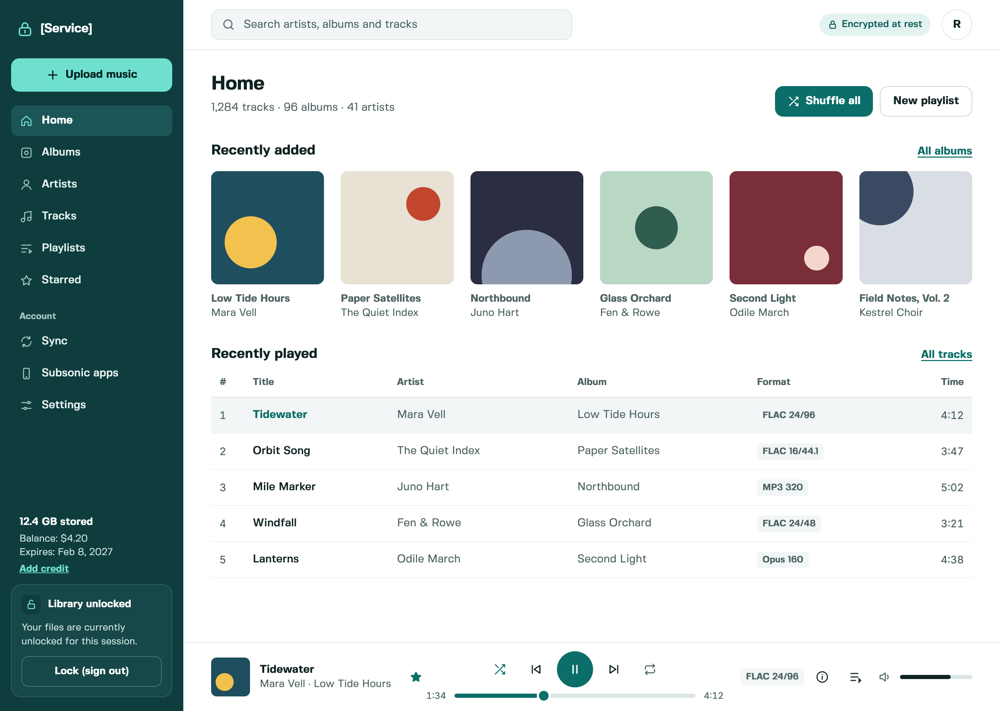
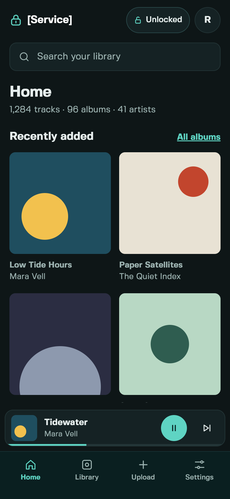

<p align="center">
  
</p>

<h1 align="center">Simple Music Server</h1>

<p align="center">
  <a href="https://github.com/chocolatemoo53/simplemusicserver/actions/workflows/ci.yml"></a>
  <a href="LICENSE"></a>
  <a href="go.mod"></a>
  <a href="https://opensubsonic.netlify.app/"></a>
  <a href="https://github.com/chocolatemoo53/simplemusicserver/releases"></a>
</p>

Simple Music Server is a place to keep the music you own. You upload your files, and you can play them in the browser or in any Subsonic app. Your library is encrypted before it is stored.

## How your library is protected

Everything in your library is encrypted at rest. That covers:

- your music files and cover art
- titles, artists, albums and track numbers
- playlists, favorites and lyrics

The storage bucket, the database and its backups only hold encrypted data. Stored files get random names, so the bucket doesn't show what they are.

<p>
  
  
</p>

<p><sub>Early designs for the web player.</sub></p>

**Each account has its own key.** It is created when you sign up. The server never stores it in a usable form. Instead, it keeps locked copies of it:

- one for your password, locked with Argon2id
- one for each signed-in browser
- one for each app password
- one for your recovery key, which you see once at sign-up

**Your library is only unlocked while you're using it.** Signing in, or connecting with an app password, opens your key for that request or session. Pressing Lock or signing out removes it. Each file also has its own key, and files are encrypted in 64 KiB chunks with AES-256-GCM. A chunk can't be changed, removed or moved without the server noticing.

**What this doesn't protect.** The server decrypts your music while you play it. Someone who controls the server while you are signed in could see what is being played. If you lose your password and your recovery key, nobody can open your library again. You can still reset your password by e-mail, but the library starts empty.

**Deleting is permanent.** Deleting a track removes every stored version of it. If the server keeps a backup copy, that copy is removed once its lock runs out.

## What it does

- Play your library in the browser, with album art, search, playlists and synced lyrics.
- Use any Subsonic or OpenSubsonic app, such as Tempus, Symfonium or Amperfy.
- Give each device its own app password, and revoke it any time.
- Upload MP3, FLAC and M4A files, or whole folders. Files stay exactly as you uploaded them.
- Download everything as one ZIP, with playlists and a list of your tracks.
- Copy your library to a computer with [tubesync](cmd/tubesync).
- Get e-mails encrypted to your OpenPGP key, if you add one.
- Pay for storage from a prepaid balance, in Monero through BTCPay or by arrangement with the operator.

### App passwords

Apps sign in with an app password, which you make in settings. There are two kinds:

- **Strict:** the server keeps nothing that can open your library. The app has to use plain-text password mode or an OpenSubsonic API key.
- **Compatibility:** works with the default Subsonic login most apps use. The server keeps a copy that can open your library, encrypted with the server's secret key.

## Running your own server

You need:

- Docker with Compose
- an S3-compatible bucket for files
- a domain and a reverse proxy with HTTPS, such as Caddy or nginx

Steps:

1. Copy `config.example.toml` to `config.toml` and fill it in.
2. Generate a secret key with `openssl rand -hex 32` and put it in `secret_key`. Keep a copy somewhere safe. Without it, compatibility app passwords and backups can't be opened.
3. Copy `.env.example` to `.env` and fill in where Litestream should back up the database.
4. Start it with `docker compose up -d`. It listens on `127.0.0.1:8000`.
5. Point your reverse proxy at it. The proxy should set `X-Forwarded-For`, which the login limits use.
6. Sign up. The first account is the admin, set by `admin_ids`.

Optional sections in `config.toml`:

- `[mail]` sends password resets and sign-up confirmations. With mail set up, the free storage only unlocks after a user confirms their e-mail.
- `[replica]` keeps a second, locked copy of every file with another provider. Each copy is locked for `lock_days`, so it can't be deleted early, even with stolen keys.
- `[billing]` sets the free storage and the price per GB.
- `[btcpay]` takes payments. Use `manual_payment` instead to add credit by hand from the admin page.

## Development

```bash
go run . -debug -cfg config.toml -assets assets
```

```bash
go test -race ./...
```

`-debug` reloads templates on change and allows cookies without HTTPS. `-assets` points at the templates, fonts and icons.

## Credits

- Based on [intertube](https://github.com/guregu/intertube) by guregu.
- [Fivo Sans](assets/fonts/OFL.txt) by Alexander Slobzheninov, under the SIL Open Font License.
- Lyrics lookups use [LRCLIB](https://lrclib.net), only for users who turn them on.

## License

[BSD 2-Clause](LICENSE)
